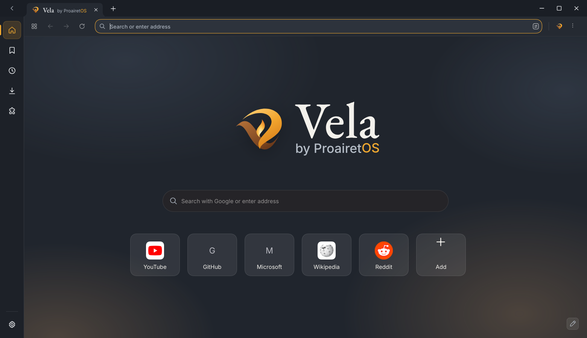

# Vela, the ProairetOS browser

**Vela** is the web browser of **ProairetOS**. Its engine is derived from
[Zen Browser](https://github.com/zen-browser/desktop), which is built on
[Mozilla Firefox](https://www.mozilla.org/firefox/). People see Vela: its name, logo, window and new tab page.



## The window

- **Tab row** across the top. The selected tab joins the toolbar under it; on the new tab page it reads
  "Vela by ProairetOS". Tabs grow in when opened and shrink out when closed. You can drag them to reorder,
  middle-click to close, and move between them with the arrow keys. Right-clicking a tab opens Firefox's own tab
  menu. These are Firefox's real tabs: session restore, shortcuts and extensions work as before.
- **Toolbar**: the grid button lists every open tab, then back, forward and reload, a rounded address field with
  the bookmark star, the Vela button and the menu.
- **Sidebar rail**: Home, Bookmarks, History, Downloads and Extensions, with Settings at the foot. A highlight
  slides to the current place. The chevron at the top left hides or shows the rail.
- **New tab page**: the Vela logo and wordmark, a search field, and shortcut tiles (YouTube, GitHub, Microsoft,
  Wikipedia, Reddit, Add). The page's parts come in one after another.
- **Colors**: the Vela button's menu offers **Vela colors** (charcoal and gold in dark, cream and gold in light)
  or **Match system colors** (the system's light or dark scheme and accent color). In the ProairetOS session,
  Match system colors uses the session's Lamplight palette.
- **Built-in refinements**: three CSS-only community-inspired refinements for the Find bar, the address bar's
  results and menus, shipped as part of the browser rather than as extensions.

Light: [docs/vela/vela-light.png](docs/vela/vela-light.png). Match system colors: [docs/vela/vela-system-colors.png](docs/vela/vela-system-colors.png).

The changes are browser-window code (`browser.xhtml`) and stylesheets, never scripts injected into websites.

## Where it lives

| File | What it is |
| --- | --- |
| `scripts/vela-native.js` | The tab row, the rail, the grid and Vela buttons, the color choice |
| `scripts/vela-chrome.css` | The window's look: palette, tab row, toolbar, rail, panels, motion |
| `scripts/vela-curated-mods.css` | The three refinements (each can be turned off, below) |
| `scripts/vela-home.css` | The new tab page; `build-vela-home.py` puts the logo and wordmark inside it |
| `scripts/vela.svg`, `vela-wordmark.svg`, `vela-icons/` | Logo, wordmark (drawn by `make-vela-wordmark.py`), line icons |
| `scripts/fonts/` | EB Garamond for the wordmark (SIL Open Font License, `OFL-EB-Garamond.txt`) |
| `prefs/zen/vela.yaml` | Vela's settings and the new tab shortcuts |
| `configs/branding/` | App icons and About-window art |

Vela's layout depends on these Zen settings, which are set in place in `prefs/`: `zen.view.use-single-toolbar` and
`zen.view.sidebar-expanded` off (the two-row window with a narrow sidebar), `zen.view.show-newtab-button-top` off
(new tabs open at the end of the row), `zen.urlbar.replace-newtab` off (the new tab page, not a floating address
bar), `zen.urlbar.behavior` normal, and `zen.welcome-screen.seen` on (Zen's own first-run welcome is skipped).

## See it without building

```bash
scripts/vela-preview.sh                  # on this screen
scripts/vela-preview.sh --shot out.png   # on a virtual screen, saving a picture
```

The preview downloads the official Zen release Vela is based on (1.24.3b; `ZEN_VERSION` picks another) into
`.vela-preview/`. It puts Vela into a copy of that release's app archive the way the build does, and starts it with
Vela's settings in its own profile. Use it to check a change to the look in seconds; the full build is still the
real thing.

## Build on Ubuntu

This repository expects the Zen/Firefox engine checkout in `engine/` and its build dependencies (and
`librsvg2-bin` for the icons). On the `proairetos` branch:

```bash
npm run init                     # first time: download and import the engine
node scripts/check-vela-port.mjs
bash scripts/apply-vela-native.sh
bash scripts/install-vela-launcher.sh   # optional: Vela in the application menu
```

`apply-vela-native.sh` links Vela's stylesheet and script into `browser.xhtml`, packages them with the logo, icons
and font, and adds the new tab stylesheet. It then brands the build (`apply-vela-branding.sh`) and runs
`mach build faster`. It is safe to run again. `package-proairetos-dev.sh` makes a development `.deb`.

## Settings

Open `about:config`:

| Preference | What it controls | Default |
| --- | --- | --- |
| `vela.theme.colors` | `vela` or `system` (also in the Vela button's menu) | `vela` |
| `vela.rail.hidden` | The sidebar rail hidden (also the chevron at the top left) | `false` |
| `vela.mods.findbar` | Find-in-page refinement | `true` |
| `vela.mods.urlbar` | Address bar results refinement | `true` |
| `vela.mods.menus` | Menu refinement | `true` |

Source inspiration and MIT attributions for the refinements: [VELA_MODS_NOTICES.md](scripts/VELA_MODS_NOTICES.md).

## Updates

On Linux, Vela is updated by its package, the way Ubuntu's and Debian's own Firefox builds are. Its `.deb` updates
through the ProairetOS update or apt, so Linux builds have no updater of their own (`configs/linux/mozconfig`;
`VELA_UPDATER=1` keeps it). Every build's update address is a reserved name that never resolves
(`updateHostname` in `surfer.json`), so no Vela build can fetch Zen's updates. About Vela's update links lead to
this repository's releases. A Windows or macOS build would need Vela's own signed update files and an update feed
before it updates itself.

## Zen's online services

Vela talks to no Zen server unless you choose to. **Sharing** spaces, folders, split views and boosts would upload them
to Zen's share server, so it is off (`zen.share.enabled`), and its address never resolves. **Zen's mods store** may not
install mods into Vela, because they are made for Zen's layout; Vela's own refinements are built in. A mod file can
still be imported in Settings.

## Branding: Vela and Zen

The product name, logo, icons and English user-visible strings are **Vela**: `surfer.json` (all build kinds),
`configs/branding/`, and `scripts/brand-vela-ui.py`. That script rewrites Firefox and Zen's English strings while
keeping keys, placeholders, line endings and URLs, and repairs translation files an older version of it damaged.

Names people don't see keep their upstream spelling, so profiles, updates from upstream and extensions keep
working. These include preference names such as `zen.view.*`, code identifiers, file paths, the `zen` executable
name and window class. Languages other than English may still show upstream labels.

## Licenses and upstream attribution

Vela is a fork of **Zen Browser**; Zen Browser is based on **Mozilla Firefox**. All upstream authors keep credit
for their work, and their licenses, including the Mozilla Public License 2.0, remain in effect. Rebranding the
browser does not change those licenses or make the engine original to Vela. EB Garamond is under the SIL Open Font
License 1.1. See the bundled license files and the [mod notices](scripts/VELA_MODS_NOTICES.md).

Changes are developed on the `proairetos` branch. The upstream names in this README are attribution, not product
branding.
